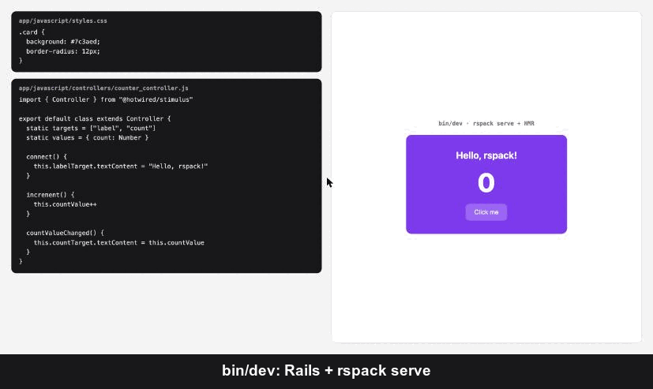

# rspack_rails

[](https://rubygems.org/gems/rspack_rails)
[](https://github.com/tungnt1203/rspack_rails/actions/workflows/main.yml)

Bundle your Rails app's JavaScript and CSS with [Rspack](https://rspack.rs), the Rust-powered, webpack-compatible bundler, and get **hot module replacement** in development.



*Above: CSS and a Stimulus controller are edited while the page is open. Both update in place, and the counter keeps its value because the page never reloads.*

rspack_rails follows the `jsbundling-rails` model: Rspack writes bundles to `app/assets/builds`, and Propshaft (or Sprockets) serves and fingerprints them in production.

**Development**
- One command setup: `bin/rails rspack:install`, then `bin/dev`
- HMR for JavaScript, CSS and Stimulus controllers, with an automatic fallback to the asset pipeline when the dev server is not running
- Stimulus autoloading: drop a `*_controller.js` (or `.ts`) in `app/javascript/controllers`, with no manifest to maintain
- Persistent cache, so rebuilds and dev server restarts reuse earlier work

**Languages and styles**
- TypeScript and CSS modules out of the box, through Rspack's built-in SWC and native CSS
- React with Fast Refresh and a `react_component` helper
- Tailwind CSS v4 and Sass, each with a migration from its Rails gem
- Images and fonts imported from JavaScript or CSS `url()`, fingerprinted for Propshaft
- Multiple entry points, including stylesheet-only ones

**Tooling**
- `rspack:migrate` moves an importmap or jsbundling app over in one command
- `rspack:doctor` checks Node.js, packages, config and layout, and says what to fix
- `rspack:analyze` writes an Rsdoctor report of what is in your production bundle

## Requirements

- Ruby 3.1+ and Rails 7.0+ (CI runs a real app on Rails 7.2 with Sprockets and 8.1 with Propshaft)
- Node.js 20.19+ or 22.12+ (whatever the installed `@rspack/core` asks for; `rspack:doctor` checks it)
- bun, yarn, pnpm or npm, detected from the lockfile

## Installation

```bash
bundle add rspack_rails
bin/rails rspack:install
bin/dev
```

The installer:

- creates `rspack.config.mjs` and `app/javascript/application.js` (an existing `application.ts`, `.jsx` or `.tsx` is kept as the entry)
- adds `build`, `build:watch` and `dev` (`rspack serve`) scripts to `package.json`
- adds `rspack_javascript_tag "application"` to your layout
- adds a `js:` process running the dev server to `Procfile.dev` and sets up `bin/dev`
- installs `@rspack/cli`, `@rspack/core` and `@rspack/dev-server`

Then add what you need:

```bash
bin/rails rspack:install:stimulus     # Stimulus with controller autoloading
bin/rails rspack:install:typescript   # type checking (TypeScript itself already compiles)
bin/rails rspack:install:react        # React with Fast Refresh
bin/rails rspack:install:tailwind     # Tailwind CSS v4
bin/rails rspack:install:sass         # Sass
```

## Migrating from importmap or jsbundling

```bash
git commit -am "Before rspack"     # rspack:migrate refuses to run on a dirty tree (FORCE=1 to override)
bin/rails rspack:migrate
git diff                           # review
bin/dev
```

**From importmap-rails**
- Every `pin` in `config/importmap.rb` becomes an npm dependency. Versions recorded by importmap (`# @1.2.3` or jspm URLs) are kept. Gem-served pins such as Turbo install the latest npm release.
- `javascript_importmap_tags` is replaced with `rspack_javascript_tag`, and `import "controllers"` with the Stimulus autoloader.
- `config/importmap.rb`, `bin/importmap`, vendored packages, the `importmap-rails` gem, `stale_when_importmap_changes` and the `bin/importmap audit` CI step are removed.
- Bare imports of app code (`import "controllers/application"`) keep working through `resolve.modules`.

**From jsbundling-rails** (esbuild, webpack, rollup)
- The `jsbundling-rails` gem, the old bundler package and its config file are removed. `Procfile.dev` runs the Rspack dev server.
- `javascript_include_tag "application"` becomes `rspack_javascript_tag`, and the generated `controllers/index.js` gives way to the autoloader.
- Extra entry files in the root of `app/javascript/` are listed so you can move them to `app/javascript/entrypoints/`.

**From tailwindcss-rails or dartsass-rails**: run `rspack:migrate` first, then [`rspack:install:tailwind`](#tailwind-css) or [`rspack:install:sass`](#sass).

The task finishes by listing any remaining lines that mention importmap or jsbundling. Shakapacker/Webpacker apps are not supported yet.

## How it works

```
            page + /rspack/*                 /rspack/* (proxied)
browser  ───────────────────▶  Rails :3000  ────────────────────▶  rspack serve :3036
   │                                                                      ▲
   └───────────────────────────── HMR websocket ──────────────────────────┘
```

- **Dev server running** (`bin/dev`): the view helpers point at `/rspack/<entry>.js`. Rails proxies those requests to `rspack serve`, so scripts, chunks, Web Workers and images are same-origin with the page. Only the HMR websocket goes to `localhost:3036` directly.
- **Dev server not running**: the helpers fall back to `javascript_include_tag` / `stylesheet_link_tag`, and Propshaft serves the last build from `app/assets/builds`.
- **Production**: always the asset pipeline. `rspack:build` runs before `assets:precompile`.

## Usage

### View helpers

```erb
<%= rspack_javascript_tag "application", "data-turbo-track": "reload" %>
<%= rspack_stylesheet_tag "application" %>
```

`rspack_javascript_tag` adds `defer` by default. Both helpers take several entries (`rspack_javascript_tag "application", "admin"`) and any option that `javascript_include_tag` or `stylesheet_link_tag` accepts. Keep `rspack_stylesheet_tag` in `<head>`.

### Entry points

Besides `app/javascript/application.js` (or `.ts`, `.jsx`, `.tsx`), every file in `app/javascript/entrypoints/` becomes its own bundle, named after the file. Stylesheets work too, with no JavaScript needed:

```
app/javascript/application.js           -> application.js
app/javascript/entrypoints/admin.ts     -> admin.js
app/javascript/entrypoints/checkout.js  -> checkout.js (+ checkout.bundle.css if it imports CSS)
app/javascript/entrypoints/print.scss   -> print.bundle.css (no print.js)
```

```erb
<%# app/views/layouts/admin.html.erb %>
<%= rspack_javascript_tag "admin" %>
<%= rspack_stylesheet_tag "print", media: "print" %>
```

`admin.js` and `admin.css` side by side make one entry. Entries can share a page: under `rspack serve` the helpers link one shared `runtime.js`, so hot updates reach every entry. Restart the dev server after adding a new entry point.

### Stimulus

```bash
bin/rails rspack:install:stimulus
```

This installs `@hotwired/stimulus` and adds `app/javascript/controllers/autoload.js`, imported from your entry. Every `*_controller.js` (or `.ts`) under `app/javascript/controllers` is registered automatically, with the usual naming (`admin/user_card_controller.js` becomes `admin--user-card`). Under `rspack serve`, editing or adding a controller hot-swaps it in the open page, so form input and other page state survive.

If your entry imported `./controllers` (the stimulus-rails index), the installer switches it to `./controllers/autoload`. stimulus-rails may still rewrite `controllers/index.js` when you run `bin/rails generate stimulus`, but nothing imports that file any more.

### CSS

Import CSS from JavaScript and Rspack extracts it to `app/assets/builds/<entry>.bundle.css`:

```js
// app/javascript/application.js
import "./styles/application.css"
```

```erb
<%= rspack_stylesheet_tag "application" %>
```

`*.module.css` files are compiled as CSS modules. Under `rspack serve`, CSS changes apply without a page reload. The `.bundle` suffix keeps the output from clashing with `app/assets/stylesheets/application.css`.

### Tailwind CSS

```bash
bin/rails rspack:install:tailwind
```

This installs `tailwindcss` and `@tailwindcss/webpack`, creates `app/javascript/application.css` with `@import "tailwindcss";`, imports it from your entry and adds `rspack_stylesheet_tag "application"` to the layout. Classes in your views, helpers and JavaScript are picked up automatically, and under `rspack serve` a new class in a view shows up without a reload.

Coming from `tailwindcss-rails` (`rails new --css tailwind`)? Run `bin/rails rspack:migrate` first, then `rspack:install:tailwind`. It moves `app/assets/tailwind/application.css` (with your `@theme`, `@plugin` and `@source` lines) to `app/javascript/application.css`, and removes the gem, the `css:` line in `Procfile.dev` and the old `tailwind.css` build.

### Sass

```bash
bin/rails rspack:install:sass
```

This installs `sass-loader` and `sass-embedded` and creates `app/javascript/application.scss`, imported from your entry. Import any `.scss` or `.sass` file from JavaScript; `*.module.scss` files are CSS modules. `app/assets/stylesheets` is a load path, so `@use "variables"` finds `app/assets/stylesheets/_variables.scss`. Inside partials, `url()` is resolved from the file that was imported from JavaScript, not from the partial.

Coming from `dartsass-rails` (`rails new --css sass`)? Run `bin/rails rspack:migrate` first, then `rspack:install:sass`. It imports `app/assets/stylesheets/application.scss` where it is, so its partials keep working, and removes the gem, the `css:` line in `Procfile.dev` and the old build. If you had custom builds in `config/initializers/dartsass.rb`, import each of those files from JavaScript.

On Sprockets, see [Sass files on Sprockets](#sass-files-on-sprockets).

### React

```bash
bin/rails rspack:install:react
```

This installs `react`, `react-dom` and React Fast Refresh, and adds `app/javascript/components/` with a sample `Hello` component. Render any component from a view:

```erb
<%= react_component "Hello", name: "World" %>
<%= react_component "admin/Chart", { points: @points }, html: { class: "chart" } %>
```

Components are found by path (`admin/Chart` is `app/javascript/components/admin/Chart.jsx` or `.tsx`) with no registration step. They mount when their element enters the page and unmount when it leaves, so Turbo Drive, frames and streams work. Props are passed as JSON. Under `rspack serve`, edits apply through Fast Refresh and components keep their state.

With TypeScript set up, the installer also sets `"jsx": "react-jsx"` in `tsconfig.json` and adds `@types/react`.

To use the [React Compiler](https://react.dev/learn/react-compiler), which memoizes components automatically, set `RSPACK_REACT_COMPILER=true`. It runs in Rspack's built-in SWC, with no Babel. Set it for every build, including `assets:precompile` on deploy, so development and production behave the same.

### TypeScript

`.ts` and `.tsx` files compile out of the box with Rspack's built-in SWC loader, including Stimulus controllers (`*_controller.ts`). SWC strips types without checking them. For type checking:

```bash
bin/rails rspack:install:typescript   # tsconfig.json, typescript, "typecheck" script
npm run typecheck
```

After that, type errors also show in the dev server overlay while you work (`ts-checker-rspack-plugin`); builds stay fast and leave checking to `typecheck`. `paths` aliases in `tsconfig.json` are honored, so `"@/*": ["./app/javascript/*"]` makes `import "@/lib/api"` work in both TypeScript and Rspack.

### Images and fonts

Import an image from JavaScript, or reference images and fonts from CSS with `url()`:

```css
body { background: url("./images/hero.png"); }
@font-face { font-family: Brand; src: url("./fonts/brand.woff2"); }
```

Files under 8 KB are inlined as data URIs. Larger ones are written to `app/assets/builds` as `<name>-<hash>.digested.<ext>`, and Propshaft serves them without fingerprinting them a second time.

## Builds and production

`rspack:build` runs automatically before `assets:precompile`, `test:prepare`, `spec:prepare` and `db:test:prepare` (set `SKIP_RSPACK_BUILD=1` to turn that off). It installs JavaScript dependencies first, then runs the `build` script with `NODE_ENV` set from `Rails.env`: `development` in development and test, `production` everywhere else.

- **Production mode**: when `RAILS_ENV` or `NODE_ENV` is `production`, the generated config minifies. Lazy-loaded chunks are named `*.digested.js`, so Propshaft serves them without fingerprinting them a second time.
- **Browser targets**: JavaScript and CSS are compiled for the browsers in your [browserslist](https://github.com/browserslist/browserslist) config (`.browserslistrc`, or `"browserslist"` in `package.json`). Without one, the target is Baseline "widely available", which matches Rails 8's `allow_browser versions: :modern`.
- **Source maps**: on in development (`cheap-module-source-map`), off in production, so your source never lands in `public/assets`. `RSPACK_DEVTOOL` picks another [devtool](https://rspack.rs/config/devtool), e.g. `hidden-source-map` to upload maps to an error tracker.
- **Lazy compilation**: under `rspack serve`, dynamic `import()`s are compiled the first time the page asks for them, which keeps startup fast in large apps.
- **Persistent cache**: kept in `node_modules/.cache/rspack`. Editing `rspack.config.mjs`, `package.json`, the lockfile, `tsconfig.json` or `.browserslistrc` starts a fresh cache; delete the directory to clear it by hand.

### Bundle analysis

```bash
bin/rails rspack:analyze
```

This runs a production build into `tmp/rsdoctor/build` (leaving `app/assets/builds` alone) and writes a single-file [Rsdoctor](https://rsdoctor.rs) report to `tmp/rsdoctor/rsdoctor-report.html`: bundle and module sizes, duplicate packages and build timings. It installs `@rsdoctor/rspack-plugin` the first time.

### Doctor

`bin/rails rspack:doctor` checks the setup and prints a hint for anything missing:

```
✓ Node.js: v22.12.0 (rspack needs ^20.19.0 || >=22.12.0)
✓ @rspack/core: 2.3.2
✓ Layout: uses rspack_javascript_tag
! Dev server: not running at http://localhost:3036
    → Start it with bin/dev; until then pages use app/assets/builds

0 error(s), 1 warning(s).
```

The task exits with status 1 when there are errors, so it can run in CI.

## Configuration

`rspack.config.mjs` and the gem read the same environment variables, so a `.env` file (loaded by foreman) changes both.

| Variable | Default | Effect |
|---|---|---|
| `RSPACK_DEV_SERVER_HOST` | `localhost` | Dev server host |
| `RSPACK_DEV_SERVER_PORT` | `3036` | Dev server port |
| `RSPACK_DEV_SERVER` | | `false` turns the dev server check off; the helpers always use `app/assets/builds` |
| `RSPACK_DEVTOOL` | `cheap-module-source-map` in development, off in production | Source map [devtool](https://rspack.rs/config/devtool); `false` turns maps off |
| `RSPACK_LAZY_COMPILATION` | on under `rspack serve` | `false` compiles every dynamic `import()` upfront |
| `RSPACK_REACT_COMPILER` | off | `true` enables the React Compiler |
| `SKIP_RSPACK_BUILD` | | Any value stops `rspack:build` from running before `assets:precompile` and test tasks |
| `FORCE` | | `1` lets `rspack:migrate` run on a dirty git tree |

Rails-side settings can also go in an initializer. This does not change `rspack.config.mjs`, so prefer env vars for host and port:

```ruby
# config/initializers/rspack_rails.rb
RspackRails.configure do |config|
  config.dev_server_port = 4000
  config.dev_server_enabled = false
end
```

## Tasks

| Task | What it does |
|---|---|
| `bin/rails rspack:install` | Sets up Rspack: config, entry, scripts, layout tag, `Procfile.dev` |
| `bin/rails rspack:install:stimulus` | Sets up Stimulus with controller autoloading |
| `bin/rails rspack:install:typescript` | Adds `tsconfig.json`, `typescript` and a `typecheck` script |
| `bin/rails rspack:install:react` | Sets up React with Fast Refresh and `react_component` |
| `bin/rails rspack:install:tailwind` | Sets up Tailwind CSS v4, migrating from tailwindcss-rails |
| `bin/rails rspack:install:sass` | Sets up Sass, migrating from dartsass-rails |
| `bin/rails rspack:migrate` | Moves an importmap or jsbundling app to Rspack |
| `bin/rails rspack:build` | Installs JavaScript dependencies, then runs `build` |
| `bin/rails rspack:clobber` | Removes Rspack output from `app/assets/builds` (also runs with `assets:clobber`) |
| `bin/rails rspack:doctor` | Checks Node.js, packages, config, layout, `Procfile.dev` and the dev server |
| `bin/rails rspack:analyze` | Writes an Rsdoctor bundle report to `tmp/rsdoctor/rsdoctor-report.html` |

## Upgrading

New versions often ship an updated `rspack.config.mjs`; the [CHANGELOG](CHANGELOG.md) says when. After `bundle update rspack_rails`:

```bash
bin/rails rspack:install   # answer "y" to overwrite rspack.config.mjs (or diff and merge your own changes)
bin/rails rspack:doctor
```

Re-running the installer is safe: it leaves your entry, layout and `Procfile.dev` alone when they are already set up. Installers for features that need a newer config (`rspack:install:sass`, `:tailwind`, `:react`) tell you when to do this.

## Troubleshooting

**Pages load old code after I stop the dev server.** `app/assets/builds` still holds the dev server's output, which loads code-split chunks from it. Run `bin/rails rspack:build` (it also runs before tests and `assets:precompile`).

**Rails 8 links the bundle twice.** The default `stylesheet_link_tag :app` links every CSS file under `app/assets`, including `application.bundle.css`. That is harmless: the dev server keeps `app/assets/builds` up to date and its own link comes later in the cascade. A rule you delete keeps applying until the next reload.

<a id="sass-files-on-sprockets"></a>
**Sass files on Sprockets** (the Rails 7 default) fail with a missing `sassc` gem. Sprockets compiles any `.scss` file under `app/assets/stylesheets` itself, through `require_tree .` and `link_directory`. Keep Sass files in `app/javascript` instead; partials in `app/javascript/stylesheets` load with `@use "stylesheets/variables"`.

**Something else.** Run `bin/rails rspack:doctor` first; it covers the usual setup mistakes.

## Development

```bash
bin/setup
bundle exec rake                      # specs + rubocop
bin/integration                       # new Rails app + every installer, build, doctor and precompile
bin/integration "~> 7.2.0"            # against a specific Rails version
bin/integration-migrate importmap     # rails new + rspack:migrate (or: jsbundling, tailwind, sass)
```

## License

Available under the [MIT License](https://opensource.org/licenses/MIT).
